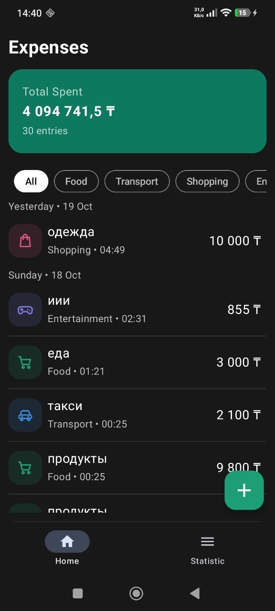
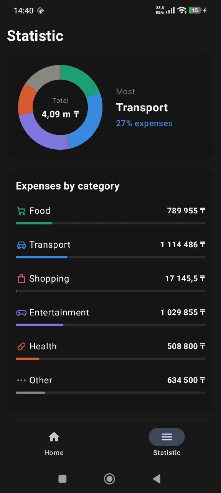
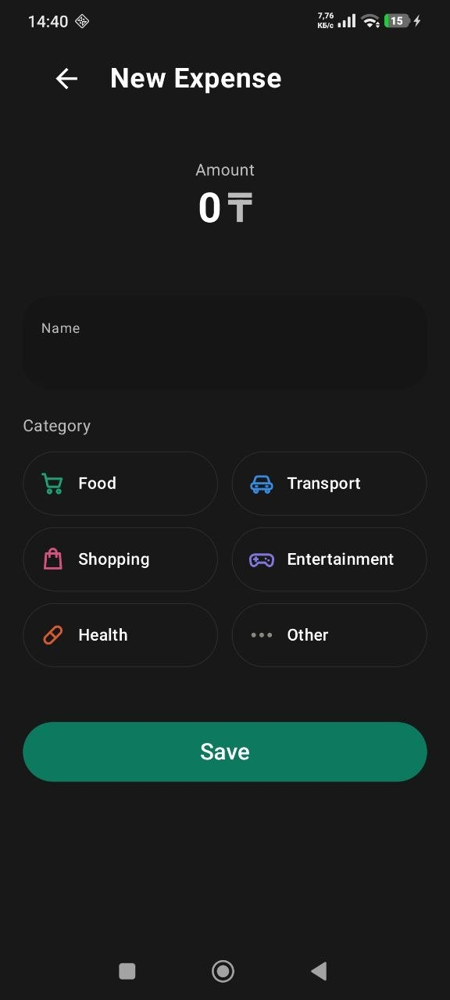
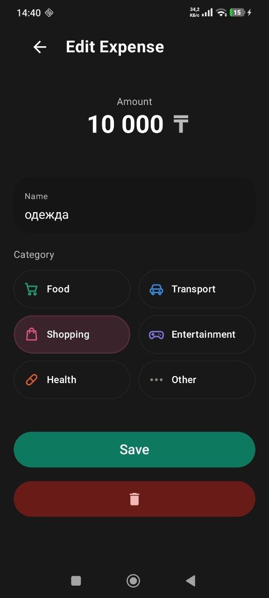

# Personal Finance

A simple Android app for tracking personal expenses. Add expenses with a category and amount, browse and filter them, and see where your money goes on a statistics screen with a chart. All data is stored locally on the device.

Built with **Kotlin** and **Jetpack Compose** using the **MVVM** pattern and a **Room** database.

## Table of Contents

- [Screenshots](#screenshots)
- [Features](#features)
- [Tech Stack](#tech-stack)
- [Architecture](#architecture)
- [Project Structure](#project-structure)
- [Getting Started](#getting-started)
- [Roadmap](#roadmap)
- [Author](#author)

## Screenshots

|              Expenses list              |                 Statistics                  |                  Add expense                  |                  Edit Expense                   |
|:---------------------------------------:|:-------------------------------------------:|:---------------------------------------------:|:-----------------------------------------------:|
|  |  |  |  |

## Features

- **Expense management** — add, edit, and delete expenses (title, amount, category, date).
- **Categories** — Food, Transport, Shopping, Entertainment, Health, and Other, each with its own icon and color.
- **Filtering** — show expenses for all categories or a single one.
- **Total spent** — a summary card with the total amount, formatted with thousands separators and the ₸ sign.
- **Statistics** — spending per category with a donut chart drawn on a Compose `Canvas`.
- **Input validation** — the form checks the title, amount, and category before saving.
- **Local storage** — expenses are saved in a Room database and survive app restarts; the database schema is migrated between versions.
- **Navigation** — bottom navigation with an active-tab indicator; the edit screen receives the expense id through a navigation argument.

## Tech Stack

| Area | Technologies |
|---|---|
| Language | Kotlin 2.0 |
| UI | Jetpack Compose, Material 3, Navigation Compose |
| Architecture | MVVM, Repository pattern, ViewModel |
| Asynchronous work | Kotlin Coroutines, Flow, StateFlow |
| Local database | Room (with KSP) |
| Build | Gradle (Kotlin DSL), version catalog |
| Tools | Git, Android Studio |

## Architecture

The app follows MVVM with a layered structure:

```
UI (Compose screens)  →  ViewModel  →  Repository  →  Room (DAO / Database)
```

- **UI** shows the state and sends user actions to the ViewModel.
- **ViewModel** holds the screen state in a `StateFlow` and talks to the repository.
- **Repository** hides the data source from the rest of the app.
- **Data layer** consists of the Room entity, DAO, and database. Entities are mapped to domain models.

## Project Structure

```
app/src/main/java/com/example/personalfinance/
├── data/local/          # Room: ExpenseEntity, ExpenseDao, FinanceDatabase, DatabaseProvider
├── domain/model/        # Expense, Categories (name, icon, color)
├── repository/          # ExpenseRepository
├── viewModel/           # ExpenseViewModel, ExpenseViewModelFactory
├── ui/
│   ├── components/      # BottomBar, CategoryIcon, ExpenseCard, TotalExpenseCard
│   ├── navigation/      # AppNavigation
│   ├── screens/         # HomeScreen, StatisticScreen, AddExpenseScreen, MainTabsScreen
│   ├── theme/           # Color, Theme, Type
│   └── utils/           # formatMoney
└── MainActivity.kt
```

## Getting Started

### Requirements

- Android Studio (latest stable version recommended)
- JDK 11 or newer (bundled with Android Studio)
- Android device or emulator with Android 7.0 (API 24) or higher

### Run the project

1. Clone the repository:
   ```bash
   git clone https://github.com/ruflexxx/PersonalFinanse.git
   ```
2. Open the project in Android Studio and wait for the Gradle sync to finish.
3. Select a device or emulator and press **Run**.

To build a debug APK from the command line:

```bash
./gradlew assembleDebug
```

### Project info

| | |
|---|---|
| Application ID | `com.example.personalfinance` |
| Min SDK | 24 (Android 7.0) |
| Target / Compile SDK | 35 |

## Roadmap

- [ ] Filter expenses by period (today, week, month, year, custom range)
- [ ] Group the expense list by date
- [ ] Unit tests for the ViewModel
- [ ] Dependency injection with Hilt

## Author

**Radmir Toizhanov** — Junior Android Developer

- GitHub: [@ruflexxx](https://github.com/ruflexxx)
- Telegram: [@ruflexm](https://t.me/ruflexm)


